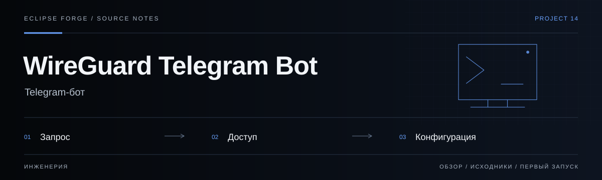

# WireGuard Telegram Bot



**Telegram-бот.** Бот доставки WireGuard-конфигураций и взаимодействия с пользователями сервиса.

<!-- repository-guide:start -->
[Первый запуск](#readme-start) · [Что внутри](#readme-map) · [Путеводитель](docs/repository-guide.md#start) · [Карта кода](docs/repository-guide.md#map) · [Проверки](docs/repository-guide.md#checks) · [Границы и права](docs/repository-guide.md#boundaries)

<a id="readme-map"></a>

## Проект за минуту

- **[Telegram-диалог](<bot.py>)** — Обработка запросов пользователя и доставка конфигураций.
- **[Provisioning](<add_client.sh>)** — Системная операция добавления клиента; не запускать при простом просмотре.
- **[Python-среда](<requirements.txt>)** — Зависимости бота для отдельного окружения.

<a id="readme-start"></a>

## Начать локально

**Среда:** Python; отдельный WireGuard-сервер для рабочего запуска. **Источник:** [requirements.txt](<requirements.txt>).

Сначала прочитайте `bot.py` и требования окружения. Установка WireGuard и `add_client.sh` меняют систему: они не входят в безопасный просмотр проекта. Токен и клиентские ключи остаются вне Git.

<details>
<summary><strong>Перед первым запуском и изменением кода</strong></summary>

- Команды сверены с исходниками 8 сентября 2026. Это инструкция, а не отметка об успешном запуске или текущем production.
- Установка зависимостей может обращаться в registry и выполнять lifecycle scripts. Используйте отдельную рабочую среду и демонстрационные данные.
- Конфигурации содержат секреты. Не публикуйте клиентские файлы, токены, журналы переписки и адреса закрытой инфраструктуры.


</details>
<!-- repository-guide:end -->

## Возможности

- Поддержка iOS, Android, Windows, Linux, macOS
- Управление через Telegram-бота (команды `/start`, `/getvpn`)
- Автоматическая генерация конфигов и ключей через shell-скрипт
- Отправка `.conf` файлов прямо в чат
- Systemd-сервис для автозапуска бота на сервере

---

## Технологический стек

| Технология | Назначение |
|---|---|
| **Python 3** | Основной язык |
| **aiogram 2.x** | Telegram Bot API фреймворк |
| **WireGuard** | VPN-протокол |
| **Bash** | Скрипт генерации клиентских конфигов |
| **systemd** | Автозапуск и управление сервисом |

---

## Быстрый старт

### 1. Подготовка сервера (Ubuntu 22.04+)

```bash
apt update && apt upgrade -y
apt install wireguard qrencode python3 python3-pip git -y
```

### 2. Установка бота

```bash
git clone https://github.com/PavelHopson/wireguard-telegram-bot.git
cd wireguard-telegram-bot
pip3 install -r requirements.txt
```

### 3. Настройка переменных окружения

Скопируйте `.env.example` в `.env` и заполните значения:

```bash
cp .env.example .env
nano .env
```

### 4. Настройка WireGuard

```bash
wg genkey | tee server_private.key | wg pubkey > server_public.key
cp wg0.conf.template /etc/wireguard/wg0.conf
nano /etc/wireguard/wg0.conf
systemctl enable wg-quick@wg0
systemctl start wg-quick@wg0
```

### 5. Запуск

```bash
python3 bot.py
```

Для автозапуска через systemd:

```bash
cp wg-bot.service /etc/systemd/system/
systemctl daemon-reload
systemctl enable wg-bot
systemctl start wg-bot
```

---

## Как это работает

1. Пользователь отправляет `/start` боту
2. Команда `/getvpn <имя>` генерирует клиентский конфиг
3. Бот вызывает `add_client.sh` для создания ключей и конфигурации
4. Готовый `.conf` файл отправляется пользователю в чат
5. Пользователь импортирует конфиг в приложение WireGuard

---

## Структура проекта

```
wireguard-telegram-bot/
├── bot.py                 # Основной код бота (aiogram)
├── add_client.sh          # Bash-скрипт генерации клиентских конфигов
├── wg0.conf.template      # Шаблон конфигурации WireGuard-сервера
├── wg-bot.service         # Systemd unit-файл для автозапуска
├── requirements.txt       # Python-зависимости
├── .env.example           # Пример переменных окружения
└── LICENSE
```

---

## Лицензия

Проект распространяется под лицензией MIT. Подробнее см. [LICENSE](LICENSE).

## Автор

**Павел Хопсон** — [GitHub](https://github.com/PavelHopson)
